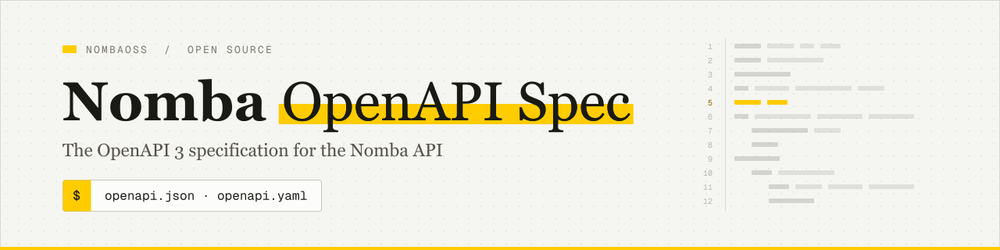

<picture>
  <source media="(prefers-color-scheme: dark)" srcset="https://raw.githubusercontent.com/NombaOSS/openapi/main/.github/assets/banner-dark.svg">
  
</picture>

# Nomba OpenAPI Spec

[](https://github.com/NombaOSS/openapi/actions/workflows/ci.yml)
[](LICENSE)

OpenAPI 3.0 specification for the [Nomba API](https://developer.nomba.com): accounts, virtual accounts, checkout, card charges, transfers, direct debits, terminals, transactions and bill payments.

100 operations across 94 paths. Production `https://api.nomba.com`, sandbox `https://sandbox.nomba.com`.

## Get the spec

Every release attaches a single bundled file:

- JSON: `https://github.com/NombaOSS/openapi/releases/latest/download/openapi.json`
- YAML: `https://github.com/NombaOSS/openapi/releases/latest/download/openapi.yaml`

Pin a tag (`/releases/download/v0.1.0/openapi.json`) if you generate code from it.

## Use it

Generate a client:

```bash
npx @openapitools/openapi-generator-cli generate -i openapi.json -g typescript-fetch -o ./nomba-client
```

Import into Postman: **Import → Link** and paste the JSON URL above.

Render it as a single HTML page:

```bash
npm ci && npm run docs   # writes dist/index.html
```

## Building with an AI coding agent?

Install the [Nomba agent skills](https://github.com/NombaOSS/skills) so Claude Code, Codex, Cursor, GitHub Copilot, Gemini CLI and other agents write Nomba integrations the safe way: idempotency references, requery on timeouts, refunds only when final, and webhook verification.

```bash
npx skills add NombaOSS/skills
```

In Claude Code you can also use `/plugin marketplace add NombaOSS/skills` and then `/plugin install nomba@nomba`.

## Where it comes from

The source of truth is the API reference at [developer.nomba.com](https://developer.nomba.com/nomba-api-reference/introduction). Each reference page embeds the OpenAPI definition for its endpoint; `npm run sync` fetches every page, merges them, and splits the result into `openapi/` (one file per path and per schema).

`openapi/` is a copy of the docs with one change: a query string is removed from one path key, because it isn't valid OpenAPI or a valid file name. The sync stops if two pages define the same thing differently, or if an endpoint page has no OpenAPI block. The docs title the API "Vendor API" with no description, so the bundled release files replace the `info` block (see `redocly.yaml`). Known issues inherited from the docs are tracked in [ALIGNMENT.md](ALIGNMENT.md).

This replaces the older `kudi-inc/vendor-openapi-spec` file, which covers 67 operations and was last updated in December 2024.

## Layout

```
openapi/
  openapi.yaml           root: info, servers, tags, path index
  paths/                 one file per path
  components/schemas/    one file per schema
scripts/sync-from-docs.mjs
redocly.yaml             lint rules and the release `info` block
.redocly.lint-ignore.yaml  baseline of known issues; shrink it, never grow it
```

## Development

| Command | What it does |
|---------|--------------|
| `npm run lint` | Lint against the recommended ruleset and the baseline |
| `npm run bundle` | Write `dist/openapi.yaml` and `dist/openapi.json` |
| `npm run sync` | Rebuild `openapi/` from the docs |
| `npm run sync -- --check` | Exit 1 if `openapi/` and the docs differ |
| `npm run docs` | Render `dist/index.html` |
| `npm run stats` | Count paths, operations, schemas |

CI lints and bundles every pull request and checks for drift against the docs every Monday.

## Releasing

Automated: merge a `chore: release X.Y.Z` PR and approve the `release` deployment. See [RELEASING.md](RELEASING.md).

## License

[MIT](LICENSE)
